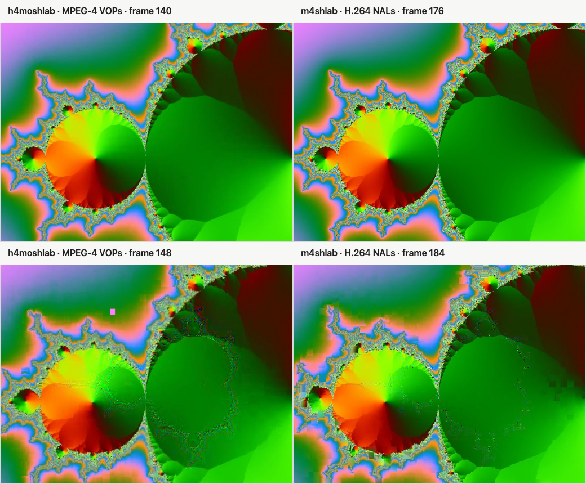
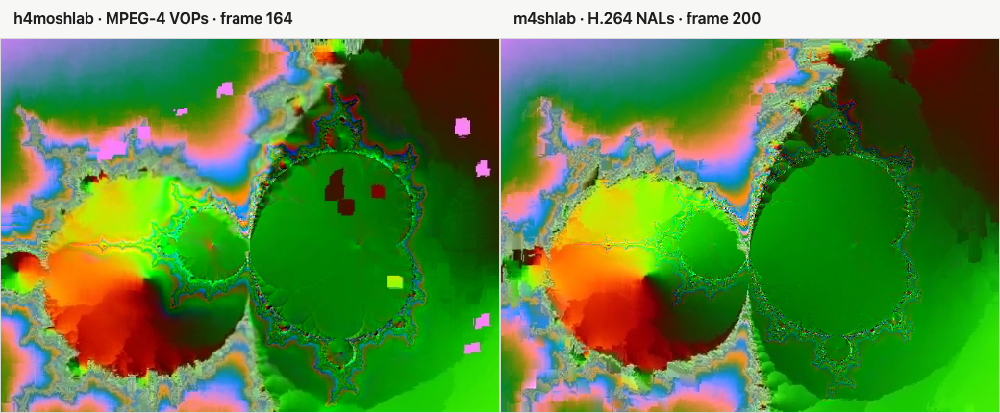
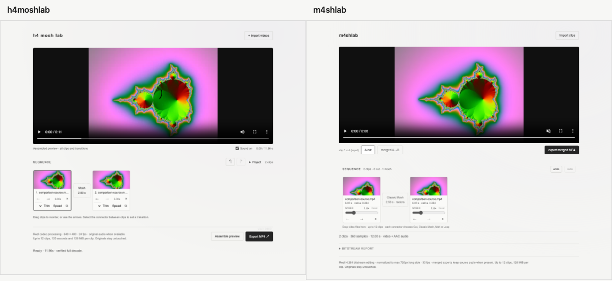
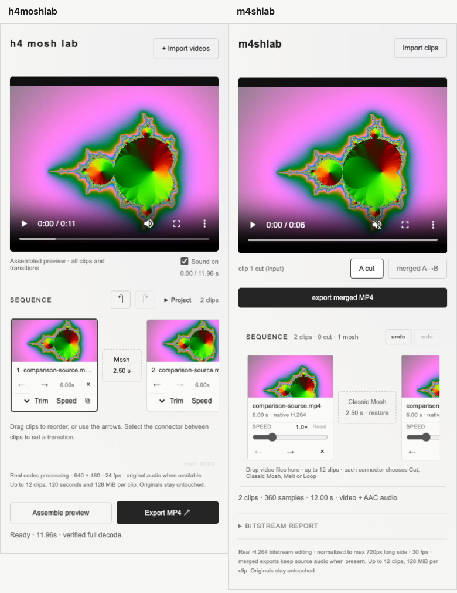

# h4moshlab ↔ m4shlab

Two independent approaches to codec-level datamoshing, shown with the same
six-second source and a matching 2.50-second Classic Mosh transition. They share
the idea of removing a clean reference and letting prediction frames inherit the
wrong image. They do not share an engine, a container format, effect code, or a
runtime.

This document compares tradeoffs. It does not rank the editors.

## Evidence from this run

- Source: synthetic Mandelbrot motion, 720×540, 30 fps, 180 frames, one leading
  IDR and no B-frames, with a 440 Hz AAC soundtrack. It is generated into
  gitignored `testmedia/` and is not committed.
- h4moshlab: `editor-workflow`, Classic Mosh, 60 frames (2.50 s), Restore.
- m4shlab: annotated `m4shlab-v1.0` tag (`2aa8ee5`), Classic Mosh, 75 frames
  (2.50 s), Restore.
- Both runs used the real local editors in Chrome 156.0.8078.80; neither engine
  was changed for the comparison.
- Raw comparison exports are local-only in `comparison/` and ignored by Git.
  Small derived PNGs and the complete measurements are committed.

| | h4moshlab | m4shlab v1.0 |
| --- | --- | --- |
| Output | 640×480 H.264 High, 24 fps, 287 frames, 11.958 s | 720×540 H.264 Constrained Baseline, 30 fps, 360 frames, 12.000 s |
| Audio | AAC-LC, 48 kHz stereo, 11.958 s | AAC-LC, 48 kHz stereo; 576,000 presented samples at 12.000 s |
| Boundary | frame 144 | frame 180 |
| Restore point | frame 204 | incoming sample 76, inserted at output frame 256 |
| Full decode | `ffmpeg -xerror -map 0 -f null -`: passed | `ffmpeg -xerror -map 0 -f null -`: passed |

The frame positions are boundary-relative in each output's native cadence:
boundary−4, boundary+4, and boundary+20. The source SHA-256 was
`32caa9441ad6175f7f10613915dd9900e4209a694ac9ed53891a5ede4fdeec47`.
Full codec, frame, hash, extraction, and screenshot measurements are in
[`comparison/render-report.json`](comparison/render-report.json).

### Boundary and late frames

Rows in the first image are boundary−4 and boundary+4. Columns are h4moshlab
then m4shlab. The second image uses boundary+20.





At boundary−4 both sides are still showing the first copy of the source, with
normal differences from 640×480 versus 720×540 encoding. At boundary+4 the two
corruption signatures are already visibly different: h4moshlab shows sharper
block and edge displacement, while m4shlab keeps more of the smooth frame structure
with errors concentrated along high-detail fractal edges. At boundary+20
h4moshlab has more widespread drifting blocks and displaced color patches;
m4shlab remains more spatially coherent but is still visibly incorrect. These
are observations from the committed frames, not a quality score.

## Architecture

### h4moshlab: local Python + FFmpeg

h4moshlab runs as a Python standard-library local server. FFmpeg normalizes input
to a temporary MPEG-4 Part 2 elementary stream at 640×480/24 fps. The engine finds
VOP start codes, removes the incoming I-VOP, and appends the retained P-VOPs
byte-for-byte against the previous clip's reference. FFmpeg decodes the manipulated
stream and re-encodes playable H.264 MP4 previews and exports.

The manipulation happens in MPEG-4 Part 2 prediction and residual data. The final
H.264 file is a playback wrapper around the result. Source audio is carried on a
separate PCM timeline and joined into the final FFmpeg export.

### m4shlab: browser H.264 NAL editing

m4shlab parses MP4 boxes and H.264 length-prefixed NAL units directly in the
browser. It removes incoming IDR units, schedules prediction samples, renumbers
slice headers when an effect requires it, and rebuilds the MP4 sample tables. No
source media leaves the device. WebCodecs handles compatible native H.264 and
HEVC conversion; ffmpeg.wasm is the fallback converter and audio muxer. The app
shell is a PWA with service-worker version `v11` at the v1.0 tag.

The manipulation happens in H.264 NAL/sample space. Retained NAL payloads are
checked for byte identity where the method does not require slice-header
renumbering.

The projects are deliberately separate implementations. No Python engine code
was transplanted into the browser app, no browser code was backported to Python,
and no GPL supermosh source is included.

## Effects and controls

### h4moshlab: seven mosh methods + Cut

Cut, Classic Mosh, Frame Melt, Progressive Melt, Motion Loop, Loop Release,
Motion Stutter, and Reset Pulse.

The editor exposes effect duration and ending controls, motion start, motion
selection for Motion Loop, presets, seeded Randomize, optional tempo matching for
selected methods, and Gentler repetition cadence for Frame Melt, Progressive Melt,
and Motion Stutter. It supports a multi-clip timeline with trim, speed, duplicate,
clip looks, undo/redo, A/B previews, and project save/relink.

### m4shlab v1.0: four mosh methods + Cut

Cut, Classic Mosh, Melt, Loop Release, and Reset Pulse. That is five timeline
method choices: four datamoshing methods plus an ordinary Cut.

Every non-Cut method exposes duration and ending. Melt adds a P-repeat factor and
Original/Gentler cadence. Loop Release adds group length and Original/Gentler
cadence. Reset Pulse adds a reset interval and P-frame repeat. The transition
dialog has seeded Randomize for Classic Mosh, Melt, Loop Release, and Reset Pulse.
The multi-clip timeline also has speed, undo/redo, reorder, duplicate, and remove,
with normalization and validation in the browser.

The method sets overlap but are not identical: h4moshlab adds Frame Melt,
Progressive Melt, Motion Loop, and Motion Stutter; m4shlab exposes Gentler cadence
on Melt and Loop Release rather than h4moshlab's three repetition effects.

## Resolution and frame cadence

### h4moshlab

- Fixed 640×480 output.
- 24 fps normalized timeline.
- Aspect ratio is preserved and letterboxed into 640×480.
- The MPEG-4 Part 2 proof stream is intentionally constrained to one initial
  I-VOP followed by P-VOPs.

### m4shlab

- Normalization and conversion use a shared target whose long side is capped at
  720 px.
- Normalized video is 30 fps, H.264, B-frame-free, `yuv420p`, with a requested
  keyframe interval of 30 frames.
- Compatible native H.264 sequence members can bypass re-encoding. The 720 px cap
  applies to normalization/conversion, not as a forced downscale in every
  pass-through pair.
- HEVC input is parsed through `hvcC` and decoded through WebCodecs or ffmpeg.wasm,
  then follows the same H.264 path.

In this run the 720×540 source stayed 720×540 in m4shlab's compatible native path,
while h4moshlab produced its fixed 640×480 result.

## Audio

h4moshlab builds a sample-aligned PCM timeline from the originals, including trim,
speed, clip order, and the one-frame drop at a Classic Mosh boundary. FFmpeg emits
the AAC track with the final video. The audio is not codec-moshed; the visible
prediction corruption does not alter the intended sample timeline.

m4shlab v1.0 also exports audio. It decodes the first track of each source with
Web Audio (ffmpeg.wasm fallback), assembles a 48 kHz stereo timeline, encodes
AAC-LC with WebCodecs, muxes with ffmpeg.wasm, and preserves the presented sample
count through MP4 timing. Classic Mosh, Loop Release, Reset Pulse, and
explicit-window Melt drop one incoming audio frame; additional picture-only frames
receive silence. Audio is not moshed, crossfaded, or mixed across multiple tracks.

> **Correction to the closeout brief:** the phrase “video-only merges” describes
> m4shlab's video transformation, not the v1.0 final export. The v1.0 app includes
> a timeline-aligned AAC soundtrack. This run produced 576,000 presented audio
> samples at 48 kHz stereo with WebCodecs encoding and ffmpeg.wasm muxing.

The practical difference is the implementation and timeline model, not absence of
audio on one side. h4moshlab's Python export keeps the audio in the same FFmpeg
job as the video; m4shlab builds video bitstreams in JavaScript and adds a separate
browser-built audio track afterward.

## UI comparison

These are full-page captures with the same clip loaded twice and the same 2.50 s
Classic Mosh applied. Desktop width is 1200 px; mobile width is 390 px. Both
mobile pages reported no horizontal page overflow.





Original captures:

- [h4moshlab desktop](comparison/h4moshlab-desktop.png)
- [m4shlab desktop](comparison/m4shlab-desktop.png)
- [h4moshlab mobile](comparison/h4moshlab-mobile.png)
- [m4shlab mobile](comparison/m4shlab-mobile.png)

### Shared visual system

The two pages are visually related. Both use Arial/Helvetica at a 14 px base,
the same light `#f5f5f3` surface and subtle radial wash, 11 px uppercase section
labels with wide tracking, transparent outlined controls, and a dark video well.
Both viewers are 380 px tall on desktop and 300 px on mobile, with `object-fit:
contain`. The dark-well treatment and neutral palette are effectively at parity.

### Typography and hierarchy

h4moshlab uses a 17 px, letter-spaced, semibold `h4 mosh lab` wordmark. m4shlab
uses an 18 px bold `m4shlab` wordmark with near-normal tracking. Both use the same
small uppercase section headings and muted 11 px hints. h4moshlab leans slightly
more on spaced labels and compact 10–12 px controls; m4shlab keeps the same scale
but gives the wordmark a little more weight.

### Desktop control placement

- Import is top-right in both.
- h4moshlab places sound, current time, and the assembled-preview label in the
  row below the viewer. Assemble and Export sit at the bottom of the sequence.
- m4shlab places the A-cut/merged toggle, preview time, and Export in the row below
  the viewer. The sequence tools and method counts sit in the sequence heading.
- Both use fixed-width clip cards and dashed transition connectors. h4moshlab
  places Trim, Speed, and Duplicate in a compact control row. m4shlab v1.0 exposes
  a full-width per-card Speed slider, making its cards taller.
- h4moshlab exposes Project, Undo, and Redo in the sequence heading. m4shlab
  exposes Undo and Redo there and puts its collapsed bitstream report below the
  sequence.

The screenshots catch each editor's post-apply default: h4moshlab shows the
assembled 11.96 s result, while m4shlab switches its preview back to the 6.00 s
A-cut and reports the completed 2-clip/360-sample merge below it. The connector in
both cases remains labeled Classic Mosh, 2.50 s.

### Mobile layout

At 390 px, both viewers reduce to 300 px. h4moshlab keeps Assemble and Export as
two side-by-side footer buttons. m4shlab moves Export into a full-width row below
the A-cut/merged controls. Both keep the timeline horizontally scrollable, so the
second card can extend beyond the visible timeline viewport without causing page
overflow.

## Verification truthfully described

- h4moshlab: **58/58 Python tests passed** with
  `python3 -m unittest discover -s tests -v`. The suite exercises MPEG-4
  manipulation, prediction payloads, audio sample timelines, HTTP jobs, and full
  decodes.
- m4shlab v1.0: **77/77 Node checks passed** with `npm test`. The suite checks NAL
  discovery and byte identity, reference removal, compatible and multi-GOP merges,
  sample-table consistency, decode counts, audio assembly and muxing, normalization,
  PWA behavior, and seeded randomization.
- Both comparison MP4s passed ffprobe frame counting and a strict full decode with
  FFmpeg 9.0.2.
- The four raw UI captures, the two labeled frame comparisons, and their exact
  dimensions are recorded in `comparison/render-report.json`.
- The deployed release referenced here is the immutable v1.0 tag, not later
  post-release work on the moving `main` branch.

## When to use which

Choose **h4moshlab** for a local Mac pipeline that needs its seven mosh methods,
buy-in to the fixed 640×480/24 fps MPEG-4 Part 2 proof pipeline, sample-exact
original-audio handling, tempo matching, and the broader Python/FFmpeg editor tool
set.

Choose **m4shlab** for browser access with no upload or local service, mobile and
PWA use, instant local export and download, HEVC import, in-browser normalization,
and the four-method H.264 workflow with seeded Randomize and optional Gentler
cadence.

Neither replaces the other. They expose different codec families and different
deployment surfaces.

## Family

- [h4ngelic — portfolio](https://h4ngelic.vercel.app/)
- [m4shlab — this browser editor](https://h333ndrik.github.io/m4shlab/)
- [h4moshlab — local Python/FFmpeg editor](https://github.com/h333ndrik/h4moshlab)
- [thr4ce — stencil editor](https://h333ndrik.github.io/thr4ce/)

thr4ce is a separate project and was not changed by this comparison block.

## Reproduction notes

The source fixture is generated, not committed:

```sh
ffmpeg -f lavfi -i 'mandelbrot=size=720x540:rate=30' \
  -f lavfi -i 'sine=frequency=440:sample_rate=48000:duration=6' -t 6 \
  -c:v libx264 -preset medium -crf 18 -profile:v baseline -bf 0 \
  -g 300 -keyint_min 300 -sc_threshold 0 -pix_fmt yuv420p \
  -c:a aac -b:a 128k -movflags +faststart testmedia/comparison-source.mp4
```

The h4moshlab comparison was rendered through its local server on port 8765. The
m4shlab comparison was rendered from an isolated checkout of tag
`m4shlab-v1.0` (`2aa8ee5536474581c05f4fe5ca30635597a0c526`) on port 4174. Frame
extraction used FFmpeg's frame index selector at the three positions recorded in
the report. The local MP4s and all source media stay ignored.
